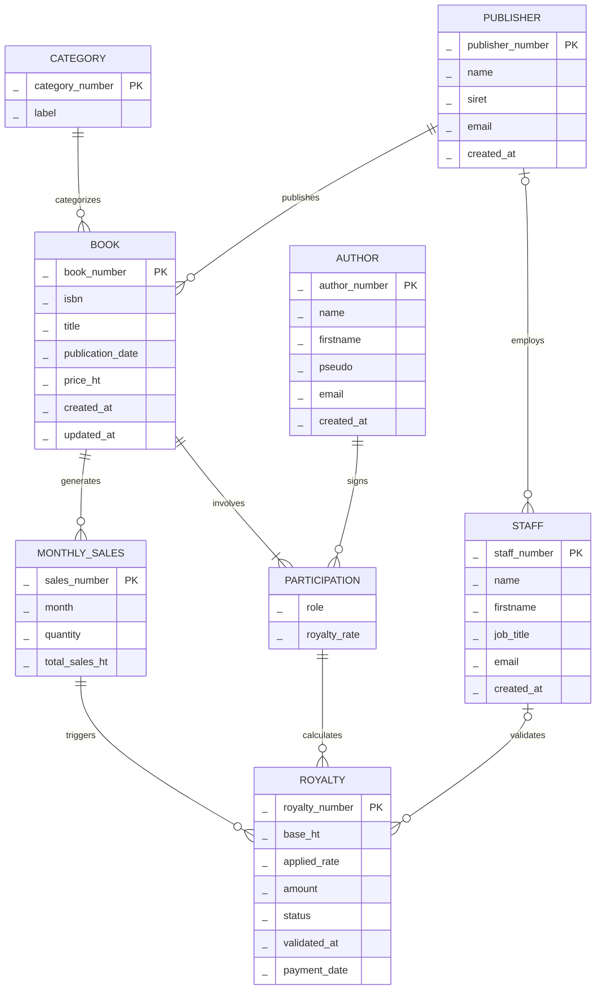
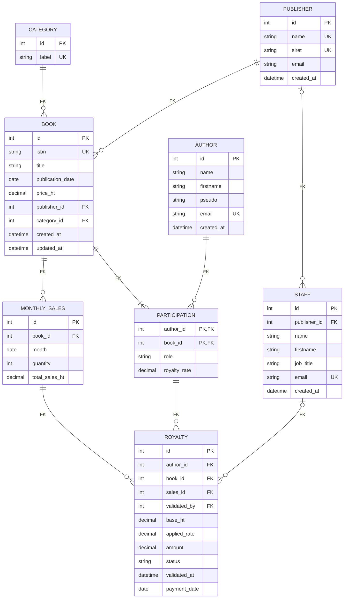

## Modélisation 1 : Gestion des redevances

### 1. Hypothèses de départ

La consigne ne précise pas comment une redevance est calculée, donc j'ai posé ces règles :
- Une redevance = **% du chiffre d'affaires HT** des ventes d'un livre sur un mois.
- Le taux est défini **par auteur et par livre**. Sur un livre à plusieurs auteurs, chacun a son propre taux (ex : scénariste 6 % + dessinateur 6 %).
- Les ventes arrivent **agrégées par livre et par mois**.
- Une redevance calculée est **figée** : si le taux d'un contrat change ensuite, l'historique ne bouge pas.
- Les 3 vues demandées (admin, comptable, auteur) sont gérées par des droits d'accès. Seul le **staff** est modélisé, parce qu'on a besoin de savoir qui a validé une redevance.

| N°  | Règle établies                                                                                                                                            |
| --- | --------------------------------------------------------------------------------------------------------------------------------------------------------- |
| 1   | Un éditeur publie 0 à N livres. Un livre est publié par 1 et 1 seul éditeur.                                                                              |
| 2   | Un livre appartient à 1 seule catégorie (roman, BD, ebook...). Une catégorie peut concerner 0 à N livres.                                                 |
| 3   | Un livre a au moins 1 auteur. Un auteur peut participer à 0 à N livres (il peut être créé avant la signature d'un contrat).                               |
| 4   | Une participation porte un rôle et un taux de redevance compris entre 0 et 100 %. Sur un livre à plusieurs auteurs, chacun a son propre taux.             |
| 5   | Un livre a 0 à N relevés de ventes mensuels, avec au maximum 1 relevé par mois.                                                                           |
| 6   | Un relevé de ventes déclenche 0 à N redevances (une par participant du livre). Une redevance correspond à 1 et 1 seul relevé.                             |
| 7   | Une participation génère 0 à N redevances, au maximum 1 par relevé de ventes.                                                                             |
| 8   | Une redevance passe par les statuts `calculated` -> `validated` -> `paid`. La date de paiement est renseignée si et seulement si le statut est `paid`.    |
| 9   | Un membre du staff valide 0 à N redevances. Une redevance est validée par 0 ou 1 membre du staff (0 tant qu'elle est au statut `calculated`).             |
| 10  | Un éditeur emploie 0 à N membres du staff. Un membre du staff travaille pour 0 ou 1 éditeur (0 = staff du groupe, qui intervient sur toutes les maisons). |

### 2. MCD

`PARTICIPATION` relie `AUTHOR` et `BOOK`. Comme elle est elle-même liée à `ROYALTY`, c'est une entité et pas une simple association. Elle n'a pas d'identifiant propre : elle est **identifiée relativement** par le couple auteur + livre.

### 3. MLD

Mermaid n'affiche pas les `UNIQUE` composites, donc je les note ici :

- `MONTHLY_SALES (book_id, month)` -> RG5
- `ROYALTY (author_id, book_id, sales_id)` -> RG7

### 5. Contraintes d'intégrité

| Table                          | Contrainte                                                 | Pourquoi                                                              |
| ------------------------------ | ---------------------------------------------------------- | --------------------------------------------------------------------- |
| `participation`                | `CHECK (royalty_rate BETWEEN 0 AND 100)`                   | Un taux est un pourcentage                                            |
| `royalty`                      | `CHECK (applied_rate BETWEEN 0 AND 100)`, `amount >= 0`    | Même logique sur la valeur figée                                      |
| `publisher`                    | `CHECK (siret REGEXP '^[0-9]{14}$')`, `UNIQUE`             | Format SIRET (nullable : éditeur étranger)                            |
| `monthly_sales`                | `CHECK (DAY(month) = 1)`                                   | Un mois est toujours stocké au 1er, pas de doublon "12/09" vs "01/09" |
| `monthly_sales`                | `UNIQUE (book_id, month)`                                  | Cf règle 5                                                            |
| `royalty`                      | `UNIQUE (author_id, book_id, sales_id)`                    | Cf règle 7, pas de double calcul                                      |
| `royalty`                      | FK composite `(author_id, book_id)` vers `participation`   | Pas de redevance pour un auteur qui n'a pas participé au livre        |
| `royalty`                      | `CHECK ((status = 'paid') = (payment_date IS NOT NULL))`   | Cf règle 8                                                            |
| `royalty`                      | `CHECK ((status = 'calculated') = (validated_by IS NULL))` | Cf règle 9 : une redevance validée ou payée a forcément un valideur   |
| `book`, `staff` -> `publisher` | `ON DELETE RESTRICT`                                       | On ne supprime pas un éditeur qui a encore des livres ou du staff     |
### 6. Choix de modélisation

- **`ROYALTY` stockée et pas seulement calculée à la volée** : le comptable valide puis paie, donc il faut un statut, une trace (qui a validé et quand) et un montant qui ne bouge pas si on modifie un taux plus tard. 
- **`ROYALTY` liée à `MONTHLY_SALES`** : on sait exactement de quel relevé vient chaque redevance, et le mois n'a pas besoin d'être recopié.
- **`STAFF` liée à `PUBLISHER` en 0,1** : un membre du staff peut travailler pour une maison d’édition précise, ou pour le groupe entier (par exemple la compta centrale). Dans ce cas, `publisher_id` reste vide. Le lien optionnel suffit à gérer les deux situations.
- **`CATEGORY` en table plutôt qu'en ENUM** : ajouter "livre audio" se fait avec un `INSERT`, pas avec un `ALTER TABLE` (avec un ENUM MySQL, il faut réécrire toute la liste des valeurs).
- **`job_title` et pas `function`** : `FUNCTION` est un mot réservé en MySQL.
- **Index** : il y aura automatiquement des index sur chaque clé étrangère, donc les jointures sont déjà couvertes. J'ajoute seulement un index `royalty(status)` pour la requête type du comptable ("tout ce qui reste à valider / à payer").
- **Montants en `DECIMAL`**, pour éviter les erreurs d'arrondi sur de l'argent.

---
## Modélisation 2 : Système de Gestion d'une Bibliothèque Universitaire

Le MLD n'étant pas visible sur la plateforme (bug), l'analyse porte sur le MCD fourni. Pour chaque erreur : son impact, la correction proposée et ce qu'elle change.

### 1. Règles MERISE

| Erreur                                                                                     | Impact                                                                                                   | Correction                                                                                                                                                                           |
| ------------------------------------------------------------------------------------------ | -------------------------------------------------------------------------------------------------------- | ------------------------------------------------------------------------------------------------------------------------------------------------------------------------------------ |
| Entités sans identifiant : EXEMPLAIRE, EMPRUNT, RESERVATION, SANCTION, ETUDIANT, CATEGORIE | Impossible de distinguer deux occurrences. Par exemple, on ne sait pas quel exemplaire précis est sorti. | Ajouter l'identifiant prévu par le cahier des charges : code-barres, n° d'emprunt, n° de réservation, n° de sanction, n° étudiant, code catégorie. Chaque occurrence devient unique. |
| LIVRE identifié par `titre`                                                                | Deux livres avec le même titre (rééditions, ...) ne peuvent pas coexister.                               | Identifier par l'**ISBN** (absent du modèle), qui est unique par édition.                                                                                                            |
| AUTEUR identifié par `nom`                                                                 | Deux auteurs homonymes ne peuvent pas coexister.                                                         | Identifier par le **code auteur**.                                                                                                                                                   |
| BIBLIOTHECAIRE identifié par `nom`                                                         | Même problème d'homonymes.                                                                               | Identifier par le **matricule**.                                                                                                                                                     |
| EDITEUR identifié par `raisonSociale`                                                      | Une raison sociale peut changer (rachat, fusion), alors qu'un identifiant ne doit jamais bouger.         | Identifier par le **code éditeur**.                                                                                                                                                  |
| EMPLACEMENT identifié par `section`                                                        | Une section contient plusieurs rayons, donc on ne peut pas les distinguer.                               | Identifier par le **code rayon**.                                                                                                                                                    |
| Types dans le MCD (`string`, `float`, `date`)                                              | Ce n'est pas bloquant, mais le MCD décrit le métier. Les types relèvent du MLD/MPD.                      | Retirer les types du MCD et les définir au MLD.                                                                                                                                      |

### 2. Différences avec le cahier des charges

| Erreur                                                         | Impact                                                                                                                                       | Correction                                                                                                               |
| -------------------------------------------------------------- | -------------------------------------------------------------------------------------------------------------------------------------------- | ------------------------------------------------------------------------------------------------------------------------ |
| EMPRUNT sans `dateRetourEffective`                             | On ne sait pas si un exemplaire est rendu. Impossible de répondre à "livres disponibles", "exemplaires disponibles" et "emprunts en retard". | Ajouter `dateRetourEffective` (vide tant que l'exemplaire n'est pas rendu). On retrouve la disponibilité et les retards. |
| SANCTION sans `dateDebut` / `dateFin`                          | Impossible de savoir qui est "actuellement sous le coup d'une sanction", ni d'empêcher un emprunt pendant une sanction.                      | Ajouter les deux dates. Une sanction est active si la date du jour est entre les deux.                                   |
| RESERVATION sans `dateExpiration`                              | On ne peut pas libérer une réservation non récupérée après 48h.                                                                              | Ajouter `dateExpiration`.                                                                                                |
| LIVRE sans `nbPages`                                           | Information demandée manquante.                                                                                                              | Ajouter l'attribut.                                                                                                      |
| ETUDIANT sans `filiere`                                        | Information demandée manquante, utile pour les statistiques.                                                                                 | Ajouter l'attribut.                                                                                                      |
| EDITEUR sans coordonnées de contact                            | Information demandée manquante.                                                                                                              | Ajouter téléphone et email.                                                                                              |
| EXEMPLAIRE : `etat` en texte libre                             | Valeurs incohérentes possibles ("Usé", "use", "abimé"). Un exemplaire "à réparer" pourrait être compté comme disponible.                     | Limiter aux 4 valeurs du cahier des charges (neuf, bon, usé, à réparer), via un type énuméré ou une contrainte au MLD.   |

### 3. Cardinalités

| Association                               | Dans le MCD                          | Correct                              | Impact de l'erreur                                                                                                                                                              |
| ----------------------------------------- | ------------------------------------ | ------------------------------------ | ------------------------------------------------------------------------------------------------------------------------------------------------------------------------------- |
| LIVRE - possède - EXEMPLAIRE              | (1,1) / (1,1)                        | LIVRE (1,N) - EXEMPLAIRE (1,1)       | **Un seul exemplaire par livre**, alors que la bibliothèque peut en posséder plusieurs.                                                                                         |
| EDITEUR - publie - LIVRE                  | (1,1) / (1,1)                        | EDITEUR (1,N) - LIVRE (1,1)          | Un éditeur ne pourrait publier qu'un seul livre.                                                                                                                                |
| LIVRE - appartient - CATEGORIE            | une catégorie ne contient qu'1 livre | LIVRE (1,N) - CATEGORIE (0,N)        | Impossible de ranger plusieurs livres dans "Roman".                                                                                                                             |
| LIVRE - est écrit par - AUTEUR            | LIVRE (1,N) - AUTEUR (0,N)           | LIVRE (1,N) - AUTEUR (1,N)           | Un livre sans auteur serait possible.                                                                                                                                           |
| EXEMPLAIRE - est rangé dans - EMPLACEMENT | (0,N) / (0,N)                        | EMPLACEMENT (0,N) - EXEMPLAIRE (1,1) | Un exemplaire pourrait être à plusieurs endroits à la fois, ce que le cahier des charges interdit.                                                                              |
| EXEMPLAIRE - est concerné par - EMPRUNT   | (1,1) / (1,1)                        | EXEMPLAIRE (0,N) - EMPRUNT (1,1)     | **Un exemplaire ne pourrait être emprunté qu'une seule fois.** Plus d'historique, et "ouvrages les plus empruntés" n'a plus de sens.                                            |
| ETUDIANT - effectue - EMPRUNT             | ETUDIANT (1,N)                       | ETUDIANT (0,N) - EMPRUNT (1,1)       | Un nouvel étudiant qui n'a jamais emprunté ne pourrait pas être enregistré.                                                                                                     |
| BIBLIOTHECAIRE - gère - EMPRUNT           | inversé                              | BIBLIOTHECAIRE (0,N) - EMPRUNT (1,1) | Un bibliothécaire ne gérerait qu'un seul emprunt, et un emprunt pourrait avoir plusieurs bibliothécaires. Pour aller plus loin en dehors du cdc, on pourrait faire (0,N)-(1,N). |
| ETUDIANT - reçoit - SANCTION              | (1,1) / (1,1)                        | ETUDIANT (0,N) - SANCTION (1,1)      | Chaque étudiant aurait obligatoirement une sanction, et une seule. Plus d'historique des sanctions.                                                                             |
| ETUDIANT - fait - RESERVATION             | (0,N) / (0,N)                        | ETUDIANT (0,N) - RESERVATION (1,1)   | Une réservation pourrait appartenir à plusieurs étudiants.                                                                                                                      |

### 4. Associations manquantes

| Manque                                 | Impact                                                               | Correction                                                                                              |
| -------------------------------------- | -------------------------------------------------------------------- | ------------------------------------------------------------------------------------------------------- |
| RESERVATION n'est reliée à aucun livre | On sait qui réserve, mais pas quoi. La réservation est inutilisable. | Ajouter LIVRE (0,N) - concerne - RESERVATION (1,1). Pas un exemplaire, on ne le connait pas à l'avance. |

### 5. Et pour le MLD ?

Le MLD n'est pas visible. S'il a été dérivé de ce MCD, il reprend forcément les mêmes erreurs. Voici ce qu'il devrait contenir une fois le MCD corrigé.

**Tables de liaison pour les associations many-to-many

- `livre_auteur (#@isbn, #@code_auteur)` : un livre a plusieurs auteurs, un auteur plusieurs livres
- `category_livre (#@isbn, #@code_categorie)` : un livre a plusieurs catégories

**Clés étrangères côté (1,1)**

- `LIVRE.code_editeur`
- `EXEMPLAIRE.isbn`, `EXEMPLAIRE.code_rayon`
- `EMPRUNT.code_barres`, `EMPRUNT.num_etudiant`, `EMPRUNT.matricule`
- `RESERVATION.isbn`, `RESERVATION.num_etudiant`
- `SANCTION.num_etudiant`

Toutes en `NOT NULL`, puisque la cardinalité minimale est 1.

**Types**

- `DECIMAL(10,2)` et pas `FLOAT` pour `prixAchat`, `penalite` et `montant`.
- `DATE` pour les dates.

**Contraintes**

- `etat` limité à `'neuf', 'bon', 'use', 'a_reparer'` (`ENUM`)
- `dateRetourPrevue > dateEmprunt` et `dateFin >= dateDebut`
- `dateRetourPrevue <= dateEmprunt + 21 jours` (règle des 3 semaines)
- `prixAchat`, `penalite`, `montant` `>= 0`
- `emailUniv` en `UNIQUE`

**Index**

- Sur les clés étrangères (automatique avec le SGBD normalement)
- Sur `EMPRUNT.dateRetourEffective`, très utilisée pour les questions "disponibles" et "en retard"

### Règles à gérer en dehors du MCD

Ces règles du cahier des charges ne se représentent pas avec des cardinalités. Elles se gèrent avec des contraintes ou encore côté application :

- 5 emprunts simultanés maximum par étudiant
- Durée d'emprunt de 3 semaines maximum
- 3 réservations maximum par étudiant
- Pas de réservation si l'étudiant a déjà un exemplaire du livre
- Pas d'emprunt pendant une sanction active